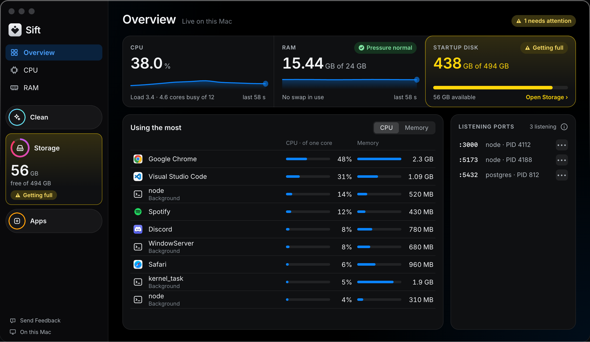

<div align="center">


# TinySift

**Know your Mac. Then clean it.**

A Mac app, free during the beta, that shows what slows your Mac and what fills its disk, then
cleans only what you pick. This repository is its open-source engine, where the rules that touch
your files live.

[](https://github.com/mxrsv/tinysift/releases)
[](https://github.com/mxrsv/tinysift/actions/workflows/ci.yml)
[](LICENSE)
[](https://tinysift.app)

[Website](https://tinysift.app) · [Download](https://github.com/mxrsv/tinysift/releases) · [Discussions](https://github.com/mxrsv/tinysift/discussions) · [Privacy](https://tinysift.app/privacy)



<sub>Sample data.</sub>

</div>

## Install

```bash
brew install --cask mxrsv/tap/tinysift
```

Or download the DMG from [tinysift.app](https://tinysift.app) or the
[Releases page](https://github.com/mxrsv/tinysift/releases). TinySift needs Apple silicon and
macOS 14 or later; every DMG is Developer ID signed and notarized by Apple
([release guide](docs/operations/release.md)). The [setup guide](https://tinysift.app/docs) covers
Full Disk Access. TinySift is in beta: watch this repository's releases to hear about new versions.

## What it does

| Screen | What you get |
| --- | --- |
| **Overview** | CPU, memory, startup disk and listening ports, live. |
| **CPU and RAM** | Every app and background process ranked by what it uses, with Quit and Force Quit ([processes](https://tinysift.app/docs#processes)). |
| **Clean** | Developer caches, logs and leftovers: Xcode DerivedData, simulators, `node_modules`, npm, pnpm, cargo and [more](docs/user/clean.md#categories). |
| **Storage** | What fills the disk, folder by folder. It only reads ([scan](docs/user/scan.md)). |
| **Apps** | Installed apps by size; Uninstall moves an app and the files it left to the Trash ([uninstall contract](docs/internals/clean.md#the-desktops-checked-uninstall)). |

## Safe by design

The rules that decide what may change on disk run in this repository's Rust engine, under the app's
screens, so you can read and test them.

- **Scanning only reads.** Nothing on disk changes until you open the review, see every path and
  confirm. The review is single-use and expires ([clean contract](docs/internals/clean.md#the-desktops-checked-removal)).
- **You pick.** Anything marked Review moves only when you tick it yourself; a folder that holds a
  Review item you did not tick is left alone ([explicit selection](docs/internals/clean.md#the-desktops-checked-removal)).
- **You see what is permanent.** Your own files, such as old downloads, only ever go to the Trash.
  Caches and build output that tools create again are deleted for good by default; a setting sends
  most of them to the Trash instead. The confirmation says how much goes each way ([removal routes](docs/internals/clean.md#the-desktops-checked-removal)).
- **Every path is checked again just before anything happens to it**
  ([`checked_execute.rs`](crates/tiny-core/src/clean/checked_execute.rs)), and a permanent deletion
  never follows a symlink or crosses to another volume ([`fs_safe.rs`](crates/tiny-core/src/clean/fs_safe.rs)).
- **Your data stays on your Mac.** No account and no analytics; the app goes online only to check
  for updates ([privacy](https://tinysift.app/privacy)).

## Command line

The same engine ships as `tiny`, a command-line tool for terminals and scripts. Build it from this
checkout with Rust 1.91 or newer, then preview a cleanup without changing anything:

```bash
cargo install --path crates/tiny
tiny clean --dry-run
```

### Commands

| Command | Guide |
| --- | --- |
| `tiny sys`, `tiny focus` | [Getting started](docs/user/getting-started.md) |
| `tiny scan` | [Scanning files](docs/user/scan.md) |
| `tiny clean` | [Cleaning caches](docs/user/clean.md) |
| `tiny uninstall` | [Uninstalling apps](docs/user/uninstall.md) |
| `tiny processes` | [Processes](docs/user/processes.md) |

## Contributing

Found a bug, or a folder TinySift missed?
[Open an issue](https://github.com/mxrsv/tinysift/issues/new/choose). Questions and ideas go to
[Discussions](https://github.com/mxrsv/tinysift/discussions).

Pull requests are welcome. Read [CONTRIBUTING](CONTRIBUTING.md) first, and run the same gates as CI:

```bash
cargo fmt --all --check
cargo test --workspace --all-targets --locked
cargo clippy --workspace --all-targets --locked -- -D warnings
```

The [documentation index](docs/README.md) leads to the architecture, the native safety contract and
the [development guide](docs/operations/development.md), including how a native client builds the
FFI library and its Swift bindings.

## License

This repository is licensed under [GPL-3.0-only](LICENSE). The code is open source; the
TinySift name and logo are not, see the [trademark policy](TRADEMARK.md). The source became
public on 2026-10-14 under the earlier MIT declaration, so copies obtained before the
relicense on 2026-10-17 remain under MIT. Third-party distribution notices for the released binaries are
still pending.
