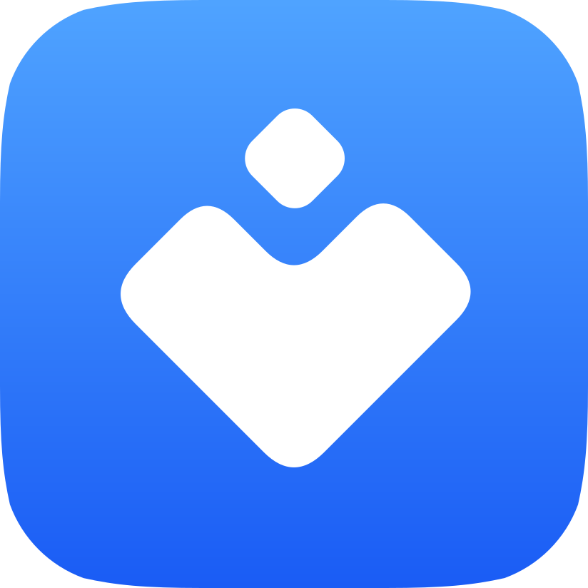
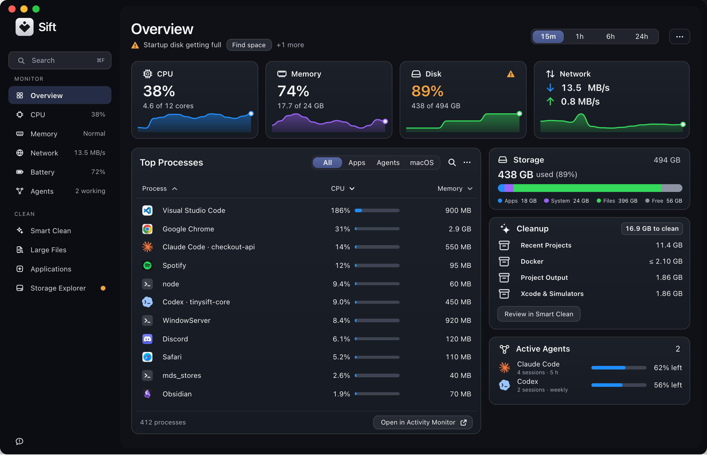
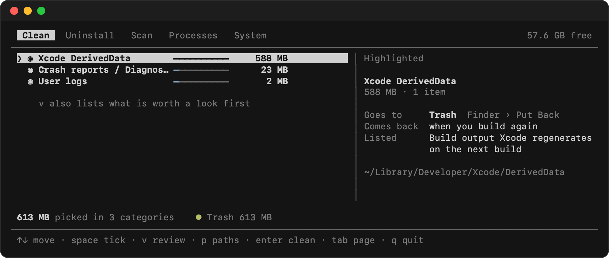

<div align="center">



# TinySift

**Know your Mac. Then clean it.**

See which app or AI agent session is slowing your Mac and what fills its disk,
then clean only what you pick.<br>
This repository is the open-source engine behind the TinySift app, and the free `sift` command-line tool.

[](https://github.com/mxrsv/tinysift/releases/latest)
[](https://github.com/mxrsv/tinysift/releases?q=cli-v)
[](https://github.com/mxrsv/tinysift/actions/workflows/ci.yml)
[](LICENSE)
[](https://tinysift.app)

[Website](https://tinysift.app) · [Download](https://github.com/mxrsv/tinysift/releases/latest) · [Setup guide](https://tinysift.app/docs) · [Discussions](https://github.com/mxrsv/tinysift/discussions) · [Privacy](https://tinysift.app/privacy)



</div>

## Quick start

| | Mac app | Command line |
| --- | --- | --- |
| **Install** | `brew install --cask mxrsv/tap/tinysift` | `brew install --cask mxrsv/tap/tinysift-cli` |
| **First run** | Open TinySift, then grant Full Disk Access ([setup guide](https://tinysift.app/docs)) | `sift clean --dry-run` lists what it would clean and changes nothing |
| **Price** | Monitor is free. Clean and Uninstall are free for 14 days, then a [$5 Lifetime license](https://tinysift.app) for one Mac | Free |

Both need Apple silicon and macOS 14 or later. Every download is Developer ID signed and
notarized by Apple ([release guide](docs/operations/release.md)). You can also download the app
DMG from [tinysift.app](https://tinysift.app) or the
[Releases page](https://github.com/mxrsv/tinysift/releases).

> **Status:** early 0.x, built by one maintainer, with new versions most weeks. Watch this
> repository's releases to hear about them.

## What the app does

| Screen | What you get |
| --- | --- |
| **Overview** | CPU, memory, disk and network at a glance, the processes using the most, and what can be cleaned. |
| **CPU and Memory** | Every app and background process ranked by what it uses, with Quit and Force Quit ([processes](https://tinysift.app/docs#processes)). |
| **Network and Battery** | Live readings; Battery ranks the apps that use it most. |
| **Agents** | Every Claude Code and Codex session, grouped by repository, with its CPU and memory. |
| **Menu bar** | The same readings in a popover; right-click for Smart Clean, Settings and updates. |
| **Smart Clean** | Developer caches, logs and leftovers: Xcode DerivedData, simulators, `node_modules`, npm, pnpm, cargo and [more](docs/user/clean.md#categories). |
| **Large Files and Storage Explorer** | What fills the disk, folder by folder (it only reads, [scan](docs/user/scan.md)), and the large files worth removing; only the ones you pick move to the Trash ([contract](docs/internals/clean.md#large-files)). |
| **Applications** | Installed apps by size. Uninstall moves an app and the files it left to the Trash ([uninstall contract](docs/internals/clean.md#the-desktops-checked-uninstall)). |

## Safe by design

The rules that decide what may change on disk live in this repository's Rust engine, under the
app's screens, so you can read and test them.

- **Scanning only reads.** Nothing on disk changes until you open the review, see every path and
  confirm. The review is single-use and expires ([clean contract](docs/internals/clean.md#the-desktops-checked-removal)).
- **You pick.** Anything marked Review moves only when you tick it yourself; a folder that holds a
  Review item you did not tick is left alone ([explicit selection](docs/internals/clean.md#the-desktops-checked-removal)).
- **You see what is permanent.** Your own files, such as old downloads, only ever go to the Trash.
  Caches and build output that tools create again are deleted for good by default; a setting sends
  most of them to the Trash instead. The confirmation says how much goes each way ([removal routes](docs/internals/clean.md#the-desktops-checked-removal)).
- **Every path is checked again just before anything happens to it**
  ([`checked_execute.rs`](crates/tiny-core/src/clean/checked_execute.rs)), and a permanent deletion
  never follows a symlink or crosses to another volume ([`fs_safe.rs`](crates/tiny-core/src/clean/fs_safe.rs)).
- **Your data stays on your Mac.** No account and no analytics; the app goes online only to check
  for updates and your license, and sends no system profile ([privacy](https://tinysift.app/privacy)).

Found a way around one of these rules? Report it privately: see the [security policy](SECURITY.md).

## Command line

The same engine ships as `sift`, a free tool for terminals and scripts. It does not need the app.

```bash
brew install --cask mxrsv/tap/tinysift-cli
sift clean --dry-run
```

The dry run lists each category with its size and safety level, then the plan, path by path (up
to 20 per category):

```text
Cleanup candidates

  User logs                     276.00 KB   safe          (6 items)
  Crash reports / DiagnosticR…  776.00 KB   safe          (13 items)

  Total: 1.03 MB
```

`sift` and `tinysift` are the same tool: if another `sift` is already on your Mac, Homebrew leaves
it alone and you type `tinysift` instead. Update with `brew upgrade --cask mxrsv/tap/tinysift-cli`.
The archive on the [Releases page](https://github.com/mxrsv/tinysift/releases) (tags `cli-v…`) is
the same signed, notarized build; [Getting started](docs/user/getting-started.md#install) also
covers building from source.

### Full-screen view

`sift` on its own opens a [full-screen view](docs/user/tui.md) with Clean, Uninstall, Scan,
Processes and System tabs. It fits a split pane down to 60×18; in a pipe or a script, `sift`
prints the help as before.



> The full-screen view is on `main` and ships with the next CLI release. `sift` 0.1.0 has the
> commands below; to try the view now, [build from source](docs/user/getting-started.md#install).

### Commands

| Command | What it does | Guide |
| --- | --- | --- |
| `sift` | Full-screen view | [Full-screen view](docs/user/tui.md) |
| `sift clean` | Clean developer caches and recoverable data | [Cleaning caches](docs/user/clean.md) |
| `sift uninstall` | Remove an app and the files it left in `~/Library` | [Uninstalling apps](docs/user/uninstall.md) |
| `sift scan` | Find large or old files; it only reads | [Scanning files](docs/user/scan.md) |
| `sift processes` | List, inspect and quit your processes | [Processes](docs/user/processes.md) |
| `sift sys`, `sift focus` | System information; a focus timer | [Getting started](docs/user/getting-started.md) |

## How it compares

- **[Stats](https://github.com/exelban/stats) or iStat Menus** give richer menu-bar graphs. TinySift
  adds AI agent sessions and cleaning in the same app. If you only want graphs, Stats is free and
  open source.
- **CleanMyMac** covers more than developer files. TinySift focuses on developer caches and app
  leftovers, and its removal rules are open source in this repository, so you can read what it
  will touch.
- **[DevCleaner for Xcode](https://github.com/vashpan/xcode-dev-cleaner)** cleans Xcode only.
  TinySift also covers `node_modules`, npm, pnpm, cargo, logs and app leftovers.

TinySift runs only on Apple silicon with macOS 14 or later. It does not remove malware or tune
system settings.

## Contributing

Found a bug, or a folder TinySift missed?
[Open an issue](https://github.com/mxrsv/tinysift/issues/new/choose). Questions and ideas go to
[Discussions](https://github.com/mxrsv/tinysift/discussions).

Pull requests are welcome. Read [CONTRIBUTING](CONTRIBUTING.md) first, and run the same gates as CI:

```bash
cargo fmt --all --check
cargo test --workspace --all-targets --locked
cargo clippy --workspace --all-targets --locked -- -D warnings
```

The [documentation index](docs/README.md) leads to the architecture, the native safety contract and
the [development guide](docs/operations/development.md), including how a native client builds the
FFI library and its Swift bindings.

## License

[GPL-3.0-only](LICENSE). The code is open source; the TinySift name and logo are not, see the
[trademark policy](TRADEMARK.md).

The source became public on 2026-10-14 under the earlier MIT declaration, so copies obtained
before the relicense on 2026-10-17 remain under MIT. Each command-line archive carries the notices
of the packages it is built from, generated at
[release](docs/operations/release.md#the-command-line-tool); notices for the app DMG are still
pending.
